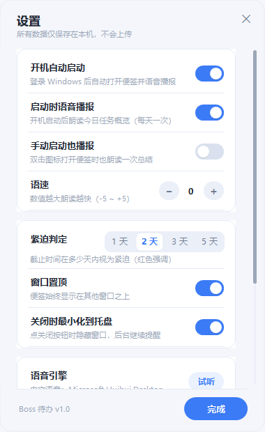

# Boss 待办 v1.0

一款 Windows 10 / 11 桌面便签式待办工具：四象限自动排序、颜色标记紧迫程度、支持手动拖拽排序、开机语音播报、托盘常驻，数据只保存在本机。

## 下载

前往 [Releases](https://github.com/a129074174/todo-list/releases/latest) 下载（无需构建环境）：

| 文件 | 说明 |
| --- | --- |
| [BossTodo-1.0.0-portable.zip](https://github.com/a129074174/todo-list/releases/download/v1.0.0/BossTodo-1.0.0-portable.zip) | 便携版：解压到任意可写目录，双击 `BossTodo.exe` 运行；请保留 `BossTodo.portable` 标记文件 |
| [BossTodo-1.0.0-setup.zip](https://github.com/a129074174/todo-list/releases/download/v1.0.0/BossTodo-1.0.0-setup.zip) | 安装版：解压后双击 `BossTodoSetup.exe`，默认安装到 `%LOCALAPPDATA%\Programs\BossTodo`，无需管理员权限 |

安装包未做代码签名，首次运行若出现 SmartScreen 提示，选择“更多信息 → 仍要运行”。


## 主要功能

- **四象限自动排序**：按“紧迫 / 重要”自动分为紧迫重要、紧迫不重要、不紧迫重要、不紧迫不重要四组；已逾期或 1 天内到期用红色强调。
- **快速添加**：顶部输入框输入内容，回车即可添加；`Ctrl+Enter` 打开完整编辑窗口。
- **任务卡片**：单击左侧圆圈标记完成；双击卡片编辑；悬停显示置顶 / 编辑 / 删除。
- **手动排序**：在“全部”筛选下按住卡片上下拖动；“恢复自动排序”可清除手动顺序。
- **筛选**：全部 / 今天 / 逾期 / 重要；底部“已完成”可展开历史任务。
- **语音播报**：启动时朗读任务概览（每天一次），也可点击“朗读总结”或按 `Ctrl+R`。
- **托盘**：关闭窗口默认最小化到托盘；双击托盘图标恢复；右键菜单可新建、朗读、设置、退出。
- **设置**：开机启动、启动播报、语速、紧迫阈值、窗口置顶、关闭到托盘、试听、数据导入导出。

| 编辑窗口 | 设置 |
| --- | --- |
|  |  |

## 系统要求

- Windows 10 / Windows 11（64 位）
- .NET Framework 4.8（Windows 10 1903 及以上通常已自带）
- 语音播报使用 Windows 自带 SAPI，建议在“设置 → 时间和语言 → 语音”中安装中文语音

## 快捷键

| 快捷键 | 功能 |
| --- | --- |
| `Enter` | 快速添加任务 |
| `Ctrl+Enter` / `Shift+Enter` | 打开完整新建窗口 |
| `Ctrl+N` | 聚焦输入框 |
| `Ctrl+E` | 新建任务窗口 |
| `Ctrl+R` | 朗读今日总结 |
| `Esc` | 隐藏到托盘 |

## 数据位置

- 安装版：`%APPDATA%\BossTodo\`（`tasks.json`、`settings.json`、出错时才生成的 `error.log`）
- 便携版：程序目录下 `Data\`（通过程序目录中的 `BossTodo.portable` 标记启用）
- 备份：设置 → 备份与恢复 → 导出 / 导入 JSON；卸载默认保留任务数据。

## 从源码构建

需要 Windows 自带的 .NET Framework 4.x 编译器（`csc.exe`）：

```powershell
powershell -ExecutionPolicy Bypass -File .\build.ps1 -TestInstaller
```

脚本会依次编译程序、运行核心自测与窗口冒烟测试、生成界面预览、编译安装程序，并在 `dist\` 下输出：

- `BossTodo-1.0.0-portable.zip`
- `BossTodo-1.0.0-setup.zip`

## 隐私

程序不发起任何网络请求，不上传任务或设置；全部数据以 UTF-8 JSON 保存在本机。

---

更完整的安装 / 卸载、静默安装说明见 [README.txt](README.txt)。
